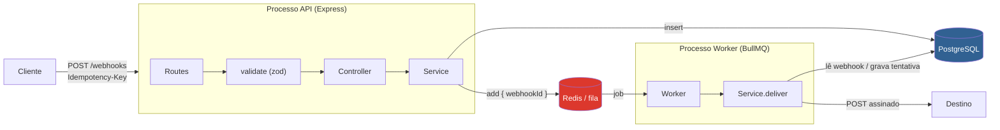
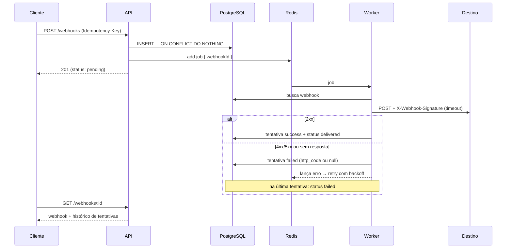
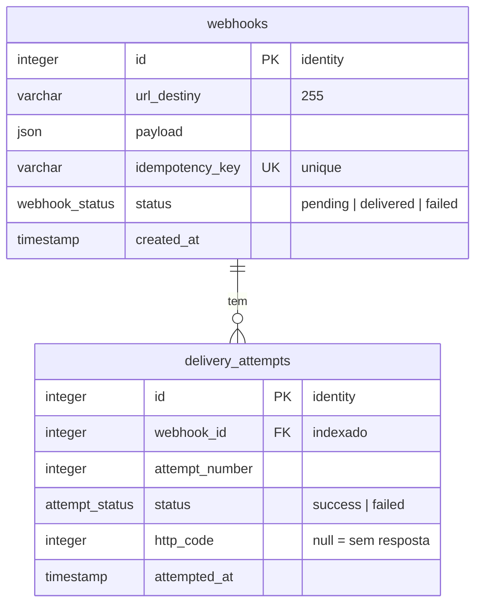

# 📨 WebhookRelay — Entrega confiável de webhooks

> Serviço que recebe webhooks de forma **idempotente** e os entrega ao destino por meio de uma **fila com retry e backoff exponencial**, assinando cada envio com **HMAC-SHA256** e guardando o histórico de todas as tentativas.

[](https://github.com/Tiagossdj/webHookRelay/actions/workflows/ci.yml)
[](https://www.typescriptlang.org/)
[](https://expressjs.com/)
[](https://docs.bullmq.io/)
[](https://orm.drizzle.team/)
[](https://www.postgresql.org/)
[](https://redis.io/)
[](https://vitest.dev/)

---

## 📑 Sumário

- [Sobre](#sobre)
- [Stack](#stack)
- [Arquitetura](#arquitetura)
- [Fluxo de entrega](#fluxo-de-entrega)
- [Modelo de dados](#modelo-de-dados)
- [Estrutura do projeto](#estrutura-do-projeto)
- [Como rodar](#como-rodar)
- [Variáveis de ambiente](#variáveis-de-ambiente)
- [Endpoints](#endpoints)
- [Verificando a assinatura](#verificando-a-assinatura)
- [Testes](#testes)
- [Decisões técnicas](#decisões-técnicas)
- [Próximos passos](#próximos-passos)
- [Limitações conhecidas](#limitações-conhecidas)

---

## Sobre

Quem envia um webhook direto para outro sistema precisa lidar com destino fora do ar, lentidão, erro 5xx e cliente que reenvia a mesma requisição. O **WebhookRelay** fica no meio e resolve isso:

- **Idempotência** — o cliente manda um header `Idempotency-Key`. A mesma key com o mesmo body devolve o registro original (`200`); com um body diferente é recusada (`409`). Requisições **simultâneas** com a mesma key geram **um único** registro.
- **Entrega assíncrona** — a API responde na hora (`201`) e um **worker separado** faz a entrega a partir de uma fila no Redis.
- **Retry com backoff exponencial** — falhou? Tenta de novo em 1s, 2s, 4s, 8s. Depois da última tentativa, o webhook vira `failed`.
- **Timeout** — um destino que aceita a conexão e nunca responde não prende o worker.
- **Assinatura HMAC-SHA256** — o destino consegue confirmar que a requisição veio do relay, que o body não foi alterado e que não é um replay antigo.
- **Histórico** — cada tentativa fica gravada com número, status e código HTTP, e pode ser consultada pela API.

---

## Stack

| Tecnologia | Uso |
|---|---|
| **TypeScript** (strict) | Linguagem, ESM com `module: nodenext` |
| **Express 5** | API HTTP |
| **Zod 4** | Validação de body, headers e params (com coerção de tipos) |
| **Drizzle ORM** + **postgres.js** | Queries type-safe e migrations |
| **PostgreSQL 16** | Fonte da verdade (webhooks e tentativas) |
| **BullMQ 6** + **Redis 7** | Fila de entregas, retry e backoff |
| **pino-http** | Logs HTTP |
| **Vitest 5** + **Supertest** | Testes unitários, de integração e end-to-end |
| **Docker Compose** | Postgres, Redis, migrations, API e worker |
| **GitHub Actions** | CI: typecheck, build e testes com cobertura |

---

## Arquitetura

API e worker são **processos separados** que compartilham o mesmo código de domínio. A API só registra e enfileira; quem fala com o destino é o worker.



**Camadas** (dentro de `src/webhook/`):

| Camada | Responsabilidade |
|---|---|
| `routes` | Liga método + caminho ao middleware de validação e ao controller |
| `validate` | Valida com zod e devolve `400` com os erros de todas as partes de uma vez |
| `controller` | Traduz HTTP ↔ service (lê a requisição, escolhe o status) |
| `service` | Regras de negócio: idempotência, consulta, entrega, retry |
| `repository` | Uma query Drizzle por método, sem regra de negócio |
| `worker` | Ponto de entrada do processo de entrega; chama `service.deliver` para cada job |

---

## Fluxo de entrega



| Caso | Tentativa gravada | Status do webhook | Retry? |
|---|---|---|---|
| Destino responde 2xx | `success`, `http_code` = status | `delivered` | não |
| Destino responde 4xx/5xx | `failed`, `http_code` = status | `pending` (`failed` na última) | sim |
| Sem resposta (rede, DNS, timeout) | `failed`, `http_code` = `null` | `pending` (`failed` na última) | sim |
| Webhook não existe mais | — | — | não (`UnrecoverableError`) |

---

## Modelo de dados



- `idempotency_key` é **unique**: é o que garante um único registro mesmo com requisições simultâneas.
- `delivery_attempts.webhook_id` tem **índice próprio**, porque o Postgres não indexa foreign keys automaticamente e o `GET /webhooks/:id` filtra por essa coluna.

---

## Estrutura do projeto

```
webHookRelay/
├── src/
│   ├── app.ts                    # Express: logs, json, rotas, error handler
│   ├── server.ts                 # Sobe a API + graceful shutdown
│   ├── worker.ts                 # Processo do worker BullMQ + graceful shutdown
│   ├── config/
│   │   └── env.ts                # Variáveis de ambiente tipadas (falha cedo se faltar)
│   ├── db/
│   │   ├── index.ts              # Conexão postgres.js + Drizzle
│   │   ├── schema.ts             # Tabelas, enums e índice
│   │   └── migrate.ts            # Aplica migrations sem drizzle-kit (usado no Docker)
│   ├── middlewares/
│   │   ├── validate.ts           # Validação zod de body/headers/params/query
│   │   └── error-handler.ts      # 500 genérico + log
│   └── webhook/                  # Feature folder
│       ├── webhook.routes.ts
│       ├── webhook.schema.ts     # Schemas zod
│       ├── webhook.controller.ts
│       ├── webhook.service.ts    # create (idempotência), getById, deliver
│       ├── webhook.repository.ts
│       ├── webhook.queue.ts      # Fila + política de retry
│       └── webhook.signature.ts  # signPayload / verifySignature (HMAC)
├── drizzle/                      # Migrations SQL geradas pelo drizzle-kit
├── tests/
│   ├── helpers/                  # Env de teste, global setup (cria bancos), reset
│   ├── unit/                     # Service e assinatura com mocks
│   ├── integration/              # Rotas com Supertest + Postgres/Redis reais
│   └── e2e/                      # API + worker como processos + destino local
├── .github/workflows/ci.yml
├── docker-compose.yml            # postgres, redis, migrate, app, worker
├── dockerfile                    # Multi-stage, node 24, usuário não-root
└── vitest.config.ts              # Projetos unit / integration / e2e
```

---

## Como rodar

### Pré-requisitos
- Node.js 24+
- pnpm
- Docker

### Opção 1 — tudo no Docker

```bash
git clone https://github.com/Tiagossdj/webHookRelay.git
cd webHookRelay

cp .env.example .env
# gere um segredo e coloque em WEBHOOK_SECRET:
node -e "console.log(require('crypto').randomBytes(32).toString('hex'))"

docker compose up -d --build
```

O compose sobe Postgres e Redis, roda as migrations (serviço `migrate`) e só então inicia a **API** e o **worker**.

API em `http://localhost:3000`.

### Opção 2 — desenvolvimento local

```bash
pnpm install
cp .env.example .env                  # preencha WEBHOOK_SECRET

docker compose up -d postgres redis   # só a infraestrutura
pnpm db:migrate

pnpm dev       # API com hot reload
pnpm worker    # worker com hot reload (outro terminal)
```

### Scripts

| Script | O que faz |
|---|---|
| `pnpm dev` / `pnpm worker` | API / worker em modo watch (tsx) |
| `pnpm build` | Compila para `dist/` |
| `pnpm start` / `pnpm start:worker` | API / worker compilados |
| `pnpm typecheck` | `tsc --noEmit` |
| `pnpm db:generate` / `pnpm db:migrate` | Gera / aplica migrations |
| `pnpm test` | Todos os testes |
| `pnpm test:unit` / `test:integration` / `test:e2e` | Um projeto de testes |
| `pnpm test:coverage` | Testes com relatório de cobertura |

---

## Variáveis de ambiente

| Variável | Obrigatória | Padrão | Descrição |
|---|---|---|---|
| `DATABASE_URL` | ✓ | — | Conexão PostgreSQL |
| `REDIS_URL` | ✓ | — | Conexão Redis |
| `WEBHOOK_SECRET` | ✓ | — | Segredo do HMAC enviado em `X-Webhook-Signature` |
| `PORT` | | `3000` | Porta da API |
| `NODE_ENV` | | `development` | `production` desliga o pino-pretty; `test` desliga o log HTTP |
| `DELIVERY_TIMEOUT_MS` | | `10000` | Tempo máximo esperando o destino responder |
| `DELIVERY_ATTEMPTS` | | `5` | Total de tentativas por webhook |
| `DELIVERY_BACKOFF_MS` | | `1000` | Atraso base do backoff exponencial (1s, 2s, 4s, 8s…) |

---

## Endpoints

**Base URL:** `http://localhost:3000`

| Método | Caminho | Descrição |
|---|---|---|
| `GET` | `/` | Health check |
| `POST` | `/webhooks` | Registra um webhook e enfileira a entrega |
| `GET` | `/webhooks/:id` | Webhook + histórico de tentativas |

### `POST /webhooks`

```http
POST /webhooks
Content-Type: application/json
Idempotency-Key: pedido-123-pago

{
  "url": "https://meu-sistema.com/webhooks",
  "payload": { "event": "order.paid", "orderId": 123 }
}
```

| Status | Quando |
|---|---|
| `201` | Webhook criado e entrega enfileirada |
| `200` | Mesma `Idempotency-Key` e mesmo body: devolve o original, sem duplicar nem reenfileirar |
| `409` | Mesma `Idempotency-Key` com body diferente |
| `400` | Header ausente, URL inválida ou `payload` ausente |

```json
{
  "id": 1,
  "url_destiny": "https://meu-sistema.com/webhooks",
  "payload": { "event": "order.paid", "orderId": 123 },
  "idempotency_key": "pedido-123-pago",
  "status": "pending",
  "created_at": "2026-10-29T18:52:00.626Z"
}
```

Erro de validação (`400`):

```json
{
  "message": "Validation error",
  "errors": {
    "body": { "url": ["Invalid URL"] },
    "headers": { "idempotency-key": ["Invalid input: expected string, received undefined"] }
  }
}
```

### `GET /webhooks/:id`

| Status | Quando |
|---|---|
| `200` | Webhook com `attempts` ordenadas por `attempt_number` (lista vazia se ainda não houve tentativa) |
| `404` | Webhook não existe |
| `400` | `id` não é inteiro ≥ 1 (`abc`, `0`, `1.5`) |

```json
{
  "id": 1,
  "url_destiny": "https://meu-sistema.com/webhooks",
  "payload": { "event": "order.paid", "orderId": 123 },
  "idempotency_key": "pedido-123-pago",
  "status": "delivered",
  "created_at": "2026-10-29T18:52:00.626Z",
  "attempts": [
    { "id": 1, "webhook_id": 1, "attempt_number": 1, "status": "failed",  "http_code": 503,  "attempted_at": "2026-10-29T18:52:01.337Z" },
    { "id": 2, "webhook_id": 1, "attempt_number": 2, "status": "failed",  "http_code": null, "attempted_at": "2026-10-29T18:52:02.401Z" },
    { "id": 3, "webhook_id": 1, "attempt_number": 3, "status": "success", "http_code": 200,  "attempted_at": "2026-10-29T18:52:04.452Z" }
  ]
}
```

---

## Verificando a assinatura

Cada entrega chega ao destino com:

| Header | Conteúdo |
|---|---|
| `X-Webhook-Id` | id do webhook. **Igual em todas as tentativas** do mesmo webhook: use para descartar duplicatas |
| `X-Webhook-Timestamp` | Unix timestamp **em segundos** (inteiro) do envio. Muda a cada tentativa |
| `X-Webhook-Signature` | `sha256=` + HMAC-SHA256 em **hex minúsculo** de `"<timestamp>.<body>"`, com o `WEBHOOK_SECRET` |

Exemplo do lado de quem recebe (Node/Express):

```ts
import express from "express";
import { createHmac, timingSafeEqual } from "node:crypto";

const SECRET = process.env.WEBHOOK_SECRET;
if (!SECRET) throw new Error("WEBHOOK_SECRET não definido");

const processedIds = new Set<string>(); // em produção: tabela com unique no id

// Registre ANTES de um app.use(express.json()) global: se o json parser rodar
// primeiro, req.body vira objeto e a assinatura nunca bate
app.post("/webhooks", express.raw({ type: "application/json" }), (req, res) => {
  const tsHeader = req.header("X-Webhook-Timestamp") ?? "";
  const received = req.header("X-Webhook-Signature") ?? "";
  const timestamp = Number(tsHeader);

  // Header ausente/inválido vira NaN, e NaN > 300 é false: checar isFinite antes
  if (!Number.isFinite(timestamp) || Math.abs(Date.now() / 1000 - timestamp) > 300) {
    return res.sendStatus(400);
  }
  if (!Buffer.isBuffer(req.body)) return res.sendStatus(400);

  const expected = "sha256=" + createHmac("sha256", SECRET)
    .update(`${tsHeader}.`) // string original do header, não o número reconvertido
    .update(req.body)       // bytes exatos que foram assinados
    .digest("hex");

  // Compara o tamanho em BYTES: timingSafeEqual lança erro se forem diferentes
  // (uma assinatura com "é" pode ter os mesmos caracteres e mais bytes)
  const a = Buffer.from(expected);
  const b = Buffer.from(received);
  if (a.length !== b.length || !timingSafeEqual(a, b)) return res.sendStatus(401);

  // Retries e replays dentro da janela de 5 min chegam com o mesmo X-Webhook-Id
  const webhookId = req.header("X-Webhook-Id")!;
  if (processedIds.has(webhookId)) return res.sendStatus(200);

  let event: unknown;
  try {
    event = JSON.parse(req.body.toString("utf8"));
  } catch {
    return res.sendStatus(400);
  }

  // ... processa o event ...
  processedIds.add(webhookId);
  res.sendStatus(200);
});
```

> Responda `2xx` também para duplicatas: qualquer outro status faz o relay tentar de novo.

A mesma comparação está em [`src/webhook/webhook.signature.ts`](src/webhook/webhook.signature.ts) (`verifySignature`), que aceita o timestamp como a string bruta do header.

---

## Testes

**41 testes em 3 projetos Vitest · ~94% de cobertura de linhas.**

```bash
docker compose up -d postgres redis
pnpm test
```

Integração e e2e usam **bancos próprios** (`webhookrelay_test` e `webhookrelay_test_e2e`) e **databases Redis próprios** (1 e 2), criados e migrados automaticamente pelo global setup. O banco de desenvolvimento nunca é tocado, e os dois projetos podem rodar em paralelo sem um apagar os dados do outro.

### Unitários — `tests/unit/` (23)

`WebhookService` isolado, com repository, fila e `fetch` mockados:

- ✅ Key nova cria e enfileira só `{ webhookId }`
- ✅ Mesma key + mesmo body → original; body diferente → conflito
- ✅ **Race condition**: perde o insert, busca o vencedor (mesmo body e body diferente), sem enfileirar duas vezes
- ✅ `deliver`: 2xx → `delivered`; 4xx/5xx → tentativa com `http_code` e erro para retry; sem resposta → `http_code: null`
- ✅ Última tentativa marca `failed`; webhook inexistente → `UnrecoverableError`
- ✅ Headers de entrega com **assinatura HMAC válida** e `AbortSignal` de timeout
- ✅ `signPayload` / `verifySignature`: segredo errado, body alterado, replay com outro timestamp, tamanho diferente, **assinatura multibyte com o mesmo número de caracteres** (não lança erro), timestamp como string bruta do header

### Integração — `tests/integration/` (14)

Supertest contra o app real, com Postgres e Redis:

- ✅ `POST` 201 / 200 / 409 / 400 (header ausente, URL inválida, payload ausente)
- ✅ **10 requisições simultâneas com a mesma key → um 201, nove 200, uma linha, um job**
- ✅ `GET /webhooks/:id` com tentativas ordenadas, lista vazia sem tentativas (não 404), 404 e 400 (`abc`, `0`, `1.5`, `-1`)

### End-to-end — `tests/e2e/` (4)

API e worker rodando como **processos separados**, um servidor HTTP local como destino e verificações apenas por HTTP:

- ✅ Entrega na primeira tentativa com payload intacto e assinatura válida
- ✅ Destino instável (503, 503, 200) → retry com backoff até `delivered`
- ✅ Destino sempre 500 → `failed` após todas as tentativas
- ✅ Destino que nunca responde → timeout, `http_code: null`, `failed`

---

## Decisões técnicas

- **Fila em vez de entregar dentro da requisição** — a API responde em milissegundos, independente do destino; retry e backoff ficam a cargo do BullMQ.
- **O job carrega só `{ webhookId }`** — o Postgres é a fonte da verdade. O worker sempre lê o estado atual do banco, e a fila não guarda cópias de payload que poderiam divergir.
- **Idempotência no banco, não em memória** — `UNIQUE(idempotency_key)` + `INSERT ... ON CONFLICT DO NOTHING`. Quem perde a corrida relê o registro vencedor. Funciona com várias instâncias da API.
- **`http_code` nulo é informação** — diferencia "o destino respondeu erro" de "o destino nem respondeu". Por isso só o `fetch` fica dentro do `try`: qualquer coisa a mais ali faria um erro de outro tipo virar "sem resposta".
- **`failed` só na última tentativa** — entre tentativas, o webhook continua `pending`; o histórico mostra cada falha.
- **`UnrecoverableError` para webhook inexistente** — tentar de novo não faz a linha aparecer; o job falha na hora, sem gastar tentativas.
- **Duas queries no `GET` em vez de JOIN** — um JOIN devolveria linhas repetidas para agrupar à mão, e um inner join esconderia webhooks sem tentativas (404 falso). Com o índice em `webhook_id`, as duas queries são baratas.
- **Assinatura sobre `timestamp.body`** — o mesmo padrão de Stripe e GitHub: prova origem e integridade, e o timestamp permite rejeitar replays. A comparação usa `timingSafeEqual`.
- **Graceful shutdown** — no `SIGTERM`, o worker para de pegar jobs e espera o atual terminar (`worker.close()`), e a API termina as requisições em andamento antes de fechar Redis e Postgres.
- **Migrations sem drizzle-kit em produção** — `src/db/migrate.ts` usa o migrator do `drizzle-orm`, então a imagem final leva só dependências de produção.

---

## Próximos passos

- [ ] **Outbox pattern** — gravar o webhook e o "pedido de envio" na mesma transação, para não perder a entrega se o Redis falhar logo após o insert
- [ ] Listagem `GET /webhooks` com filtros por status e paginação
- [ ] Segredo por destino (hoje é um `WEBHOOK_SECRET` global) e rotação de segredo
- [ ] Autenticação da API (API keys) e rate limiting
- [ ] Endpoint para reenviar manualmente um webhook `failed`
- [ ] Documentação OpenAPI / Swagger
- [ ] Métricas (taxa de sucesso, latência do destino, tamanho da fila)

---

## Limitações conhecidas

### Webhook pode ficar `pending` sem job
O insert no Postgres e o `add` no Redis não são atômicos. Se o Redis cair entre os dois, o webhook fica salvo mas nunca é entregue. A solução planejada é o **outbox pattern** (ver Próximos passos).

### Entrega "pelo menos uma vez" (*at-least-once*)
Se o worker cair depois de o destino receber o POST, mas antes de gravar o sucesso, o job é reprocessado e o destino recebe o mesmo webhook de novo. O destino deve usar o header `X-Webhook-Id` para descartar duplicatas, prática comum em provedores de webhook.

### SSRF
A URL de destino é livre, então alguém com acesso à API poderia apontar para endereços internos da rede onde o worker roda. Em produção, seria necessário bloquear IPs privados e de metadata (ex.: `169.254.169.254`) ou usar uma allowlist de domínios.

### Sem autenticação
Qualquer cliente que alcance a API pode registrar webhooks. O projeto foca na confiabilidade da entrega; autenticação está nos próximos passos.

---

⭐ Se este projeto te ajudou, deixe uma estrela!
